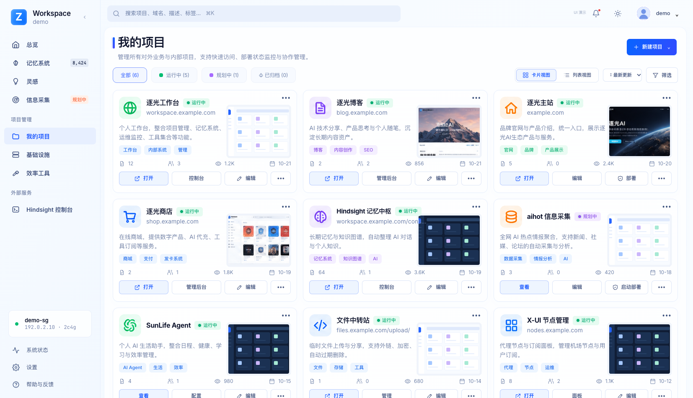
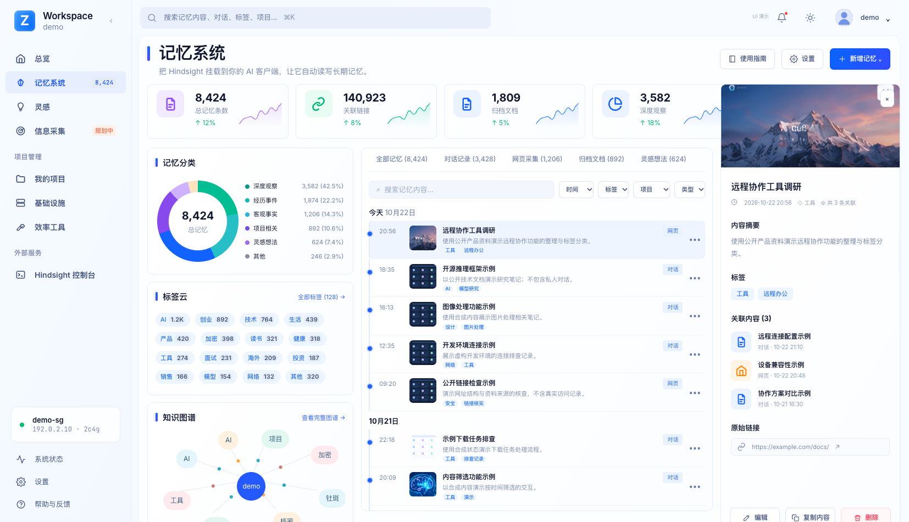
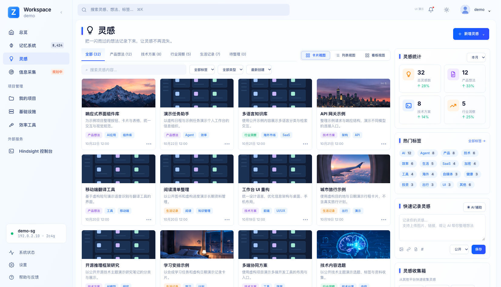
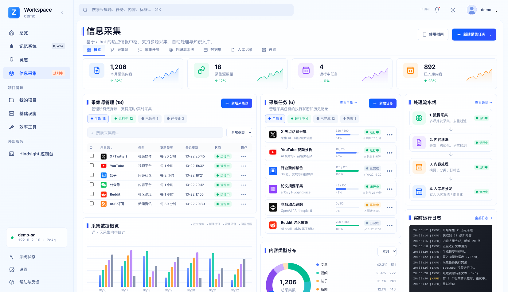
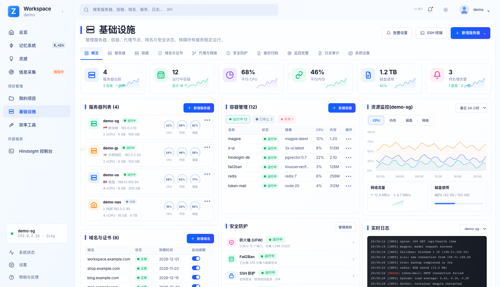
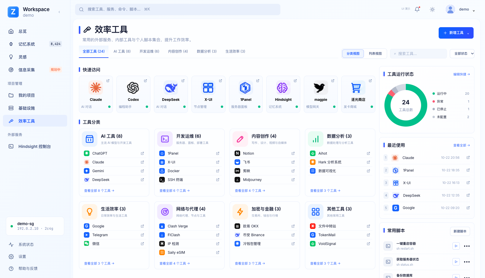
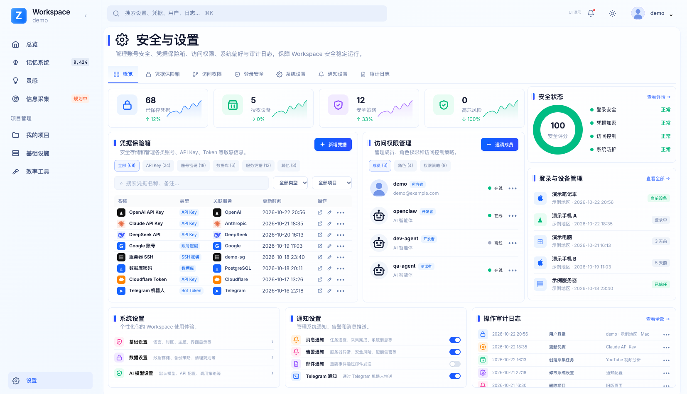
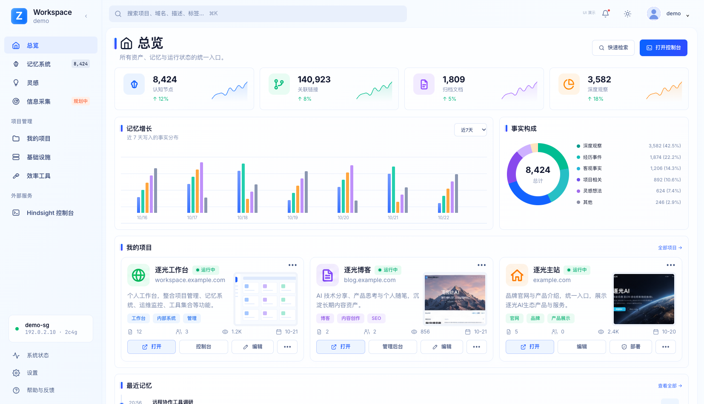

# ZGATRI Workspace

**English** | [简体中文](README.zh-CN.md)

A self-hosted personal workspace for memory, ideas, projects, tools, and infrastructure. Built with vanilla HTML, CSS, JavaScript, and a Node.js/SQLite API, with an optional Hindsight memory backend.

[Quick start](#quick-start) · [Screenshots](#screenshots) · [Workbench guide](workbench/README.md) · [Deployment](workbench/DEPLOY.md)

## Features

| Area | What the UI includes |
| --- | --- |
| Projects | Cards, list view, status filters, project details and editing |
| Memory | Categories, tags, timeline, related content and a detail panel |
| Ideas | Card/list/board layouts, search, tags and quick capture |
| Information collection | Sources, tasks, processing pipeline and logs |
| Infrastructure | Servers, containers, domains, monitoring and security panels |
| Tools | Shortcuts, categories, recent activity and script entries |
| Security and settings | Credential metadata, members, devices, preferences and notifications |
| Overview | A shared entry point for memory metrics and project cards |

The default **UI demo** presents the reference layout using synthetic content. Switch to **actual data** to use configured, same-origin APIs. Some collection, monitoring, permissions and memory-editing controls are UI placeholders; they do not execute production operations. Demo counters are illustrative, not live service or security metrics.

## Quick start

Requires Node.js 22.18 or later. From the repository root:

```sh
git clone https://github.com/Ti08X/zgatri-workspace.git
cd zgatri-workspace
npm run preview:workbench
```

Open [http://127.0.0.1:8898/#projects](http://127.0.0.1:8898/#projects). The preview serves static files only and does not connect to a production database. See the [workbench guide](workbench/README.md) for API setup, configuration and checks.

## Screenshots

All images below are regenerated from the public code with sanitized, synthetic data. Addresses, accounts, device details and memory entries are examples. Text-bearing private thumbnails are replaced with synthetic artwork. [Browse all 16 desktop/mobile images](workbench/docs/ui-redesign-2026-10.md).

### Projects



[Mobile preview](workbench/docs/screenshots/projects-mobile.png)

### Memory



[Mobile preview](workbench/docs/screenshots/memory-mobile.png)

### Ideas



[Mobile preview](workbench/docs/screenshots/ideas-mobile.png)

### Information collection



[Mobile preview](workbench/docs/screenshots/intel-mobile.png)

### Infrastructure



[Mobile preview](workbench/docs/screenshots/infra-mobile.png)

### Tools



[Mobile preview](workbench/docs/screenshots/tools-mobile.png)

### Security and settings



[Mobile preview](workbench/docs/screenshots/settings-mobile.png)

### Overview



[Mobile preview](workbench/docs/screenshots/overview-mobile.png)

## Project structure

```text
workbench/
  portal/       Current workspace UI and assets
  server.mjs    Node.js/SQLite workspace API
  scripts/      Static preview and isolated API/UI checks
  docs/         Redesign notes and sanitized screenshots
```

The other `src/`, `server/`, `public/` and integration directories retain the earlier Memory Hub implementation. Its [historical guide](docs/legacy-memory-hub-readme.md) documents that separate implementation; it is not the entry point for the redesigned workspace.

## Documentation

- [Workbench usage and configuration](workbench/README.md)
- [Deployment and operations](workbench/DEPLOY.md)
- [UI redesign and screenshot gallery](workbench/docs/ui-redesign-2026-10.md)
- [Public-release verification](workbench/docs/public-release-verification.json)
- [Historical Memory Hub documentation](docs/legacy-memory-hub-readme.md)

Keep authentication at the reverse proxy and the API on loopback. This source distribution contains no production database, private archive, credentials or backups.

## License

[ISC](LICENSE)
