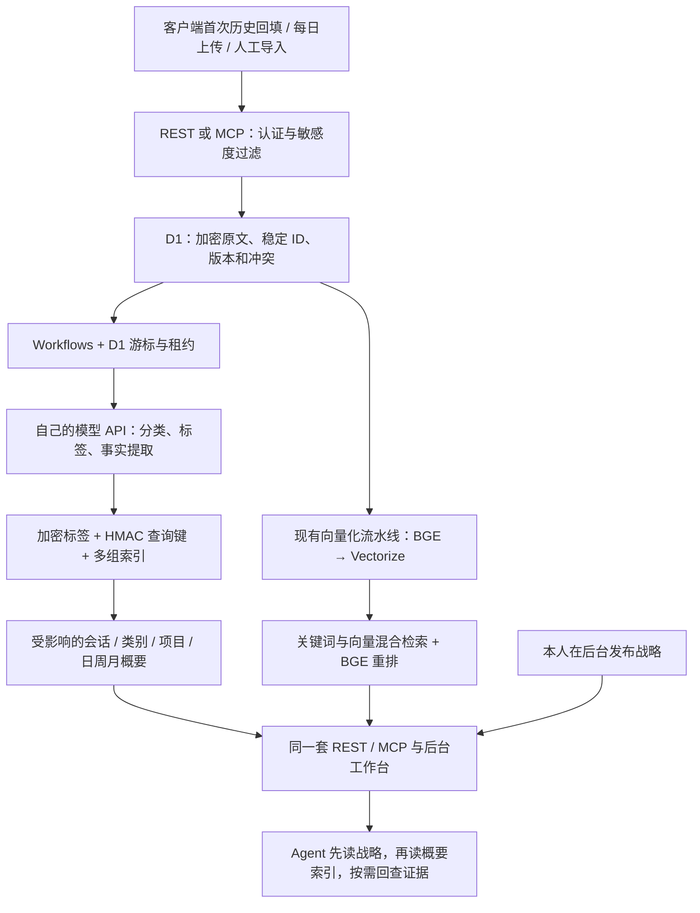

# 增量记忆工作台 · 已发布

> Production now uses the server runtime described in [server deployment](server-deployment.md). Cloudflare/Workflows references below describe the original implementation; equivalent server tasks retain the same SQL leases, cursors and permission checks.

2026-10-15 发布至 https://pw.zgatri.com/dashboard，版本 fe3a1e14-d7f1-40a8-9ee0-228da5cb9d83。已应用 0008、启用真实云端增量整理；首次整理未完成不代表资料未入库。核心采用纯 Cloudflare 方案；不需要 AWS、GPU 或本地常驻大模型。嵌入与重排沿用硅基流动 BGE 非 Pro 模型，分类/标签/概要使用本人在模型设置中配置的外部 API。没有应用层每日模型调用额度。这个版本不改变客户端每天同步聊天的计划。

## 这次完成什么

| 功能 | 已实现行为 |
| --- | --- |
| 多分类 | 个人、开发、工作、健康、学习可重叠；“其他”单独使用。保留手工修订，修改索引不改原文。 |
| 多标签与项目 | 一条原文可属于多个标签和项目；加密保存名称，以 HMAC 键精确查找。详情页可以纠正。 |
| 单条提取 | 按原文 ID / 版本保存分类、主题标签和有证据的事实摘要，不以助手建议冒充个人经历。 |
| 六种概要 | 会话、类别、项目、上海日期的日 / 周 / 月概要；周一为周起始日。每条概要带修订号与原文版本引用。 |
| 增量整理 | 新来源只追加处理到相关分组；未变化的原文提取复用。修订、删除或重新分类时，受影响分组从当前证据重建。 |
| 断点续跑 | Workflows 编排、D1 游标/租约、来源版本/分类修订校验、失败退避与手动重试；每一步只持久化 ID、状态和计数。 |
| 接手 | 正式战略先行，后读有界的类别、项目和近期月份概要索引，再按需展开；后台和 AI 共用相同权限及读接口。 |
| 后台 | 八类工作台：覆盖、导入、进度、标签、时间、项目、接手、质量。总览保留图标、今日新增和分类图。 |

## 如何使用

1. 在“模型设置”配置并启用概要 API。分类与多层概要会调用这个服务，费用由所选服务决定；嵌入和重排继续使用原来的硅基流动配置。
2. 打开“记忆工作台”，开启增量整理。首次会处理已经提交的可读原文；以前生成的有效提取可以复用。
3. “处理下一批”用于本地检查或手动推进；线上定时触发 Workflow 后会继续处理。暂停会阻止在途模型结果继续提交。
4. 查看“已提取”和“概要状态”，两者不是同一个完成指标。失败来源保留原文与成功进度；修复模型服务后可重试失败任务。
5. 点击类别、项目或时间概要，展开详情与原文出处；原文详情可修改分类、标签和项目归属。
6. 用“AI 接手预览”核对当前登录权限的战略与概要。不同 Key 读取结果可以不同：敏感等级、scope、集合权限同时生效。

## AI 接入和接口

URL 沿用 `/mcp` 和 `/v1`，不需要新的授权文件。每个 AI 继续使用单独的 Bearer API Key；普通 AI 不获得管理权限。

| MCP | REST | 作用 |
| --- | --- | --- |
| get_handoff | GET /v1/handoff | 战略优先、按需补读的接手入口 |
| get_overview | GET /v1/overview | 类别、项目和近期月份概要组成的概览；不是把全部聊天放进一次请求 |
| list_memory_summaries | GET /v1/library/summaries | kind=conversation/category/project/day/week/month，cursor/limit 分页 |
| get_memory_summary | GET /v1/library/summaries/{scope_id} | 一份当前概要与证据版本 |
| find_memory_by_label | GET /v1/library/records | kind=tag/project，name 精确标签或项目名，分页原文 |
| set_memory_labels | POST /v1/library/labels | 多分类、多标签、项目修订；需来源版本与两个 CAS 修订号 |
| search_memory | GET /v1/search | 既有全文 / 混合 / 重排检索，分类已扩展为六类 |
| 无管理 MCP | GET /v1/library/labels/{record_id} | 读取标签和分类修订号，供写入前核对 |
| 无管理 MCP | GET /v1/library/status、/insights | 处理状态、平台覆盖、回执和权限内的质量信息 |
| 无管理 MCP | POST /v1/library/control、/process、/retry | 仅具有完整 L3 读写、所有集合和 admin 的整理器；不是普通 AI Key |

Skill 已补充新工具和 REST 命令：`summaries --kind month`、`scope --scope-id ...`、`find-label --kind tag --name ...`、`labels --record-id ...`。接手时优先消费本轮已有证据，不重复生成同一份概要。所有归档仍由实际采集器/每日任务执行，Skill 不会读取官方平台私有聊天。

## 数据组织与安全

| 表 | 内容 |
| --- | --- |
| library_settings | 开关、控制修订、整理客户端、租约 |
| library_labels | 与原文版本 / 分类修订绑定的加密标签及项目归属 |
| library_label_keys | HMAC 标签 / 项目查询键，不存明文名称 |
| library_scopes | 分组索引、加密标题、工作游标、当前概要和失败状态 |
| library_members | 原文 ID / 版本到多个分组的关系 |
| library_summary_versions | 加密概要修订留档；本版尚未提供历史版本浏览界面 |
| library_source_errors | 脱敏错误代码、尝试次数、下次重试时间 |
| library_import_receipts | 本版开始的新增/修订、去重、冲突计数，无正文 |

概要在读出时校验整个分组的当前来源权限、版本和分类修订。分组包含当前 Key 无权读取的资料时，该分组不返回标题或正文；不会让低权限 AI 从高敏感概要获知内容。标签查询、统计和失败记录同样过滤权限。来源修改/删除触发概要失效；在途结果需再次核对代数与来源，不能覆盖更新后的索引。正式战略的增删改发布仍只允许本人网页会话，Agent 包括 L3/admin Bearer 都只读。

处理批大小和租约是单次任务的资源控制，不是用户的每日调用额度。当前 Workflow 每次最多推进八轮，下一次计划触发继续；每轮最多提取两条、合并一组的十二条新提取。模型超时 90 秒、失败五分钟后可再尝试，手动重试可提前排队。已有的网络/API 防滥用与供应商限流不因此消失。

## 本版边界

- 平台覆盖只统计已提交资料，长消息分段会计作多条记录；不能据此声称账户全部历史。
- 导入回执从本版开始累计，不凭空补造早期批次；目前是批次接收回执，没有大 ZIP 文件上传任务管理。
- 标签概览是最近最多 100 条已整理资料的样本，明确标注是否全覆盖；精确标签查询会查可见全库并分页。
- 类别/项目名称来自模型或手工确认；尚未提供跨记录的全局同义词合并与实体管理。
- 新增来源做增量合并；原文修订/删除/改分类时对受影响分组重建，以免旧事实残留。这不是每次都重读全部库。
- 接手入口最多给六类、八个项目和最近两个月，更多通过索引分页展开。不是一份无限长度的“全量上下文”。
- 大 ZIP 暂时仍在 Mac 解析后导入。私有 R2 大文件上传、后台流式解包、文件级失败恢复是后续独立功能，未在本版假装完成。
- 本地测试使用合成文本和模拟模型；发布后已观察到真实原文提取，初次全库整理仍在进行，模型结果需要持续结合出处核对。

## 发布顺序（2026-10-15 已授权常规更新直接上线）

1. 运行本地 TypeScript、隔离 HTTP / MCP / D1 / Workflows 测试与网页检查。
2. 用现有私有备份流程保存当前已应用的 D1 表与独立主密钥备份；新备份脚本已纳入八张 library 表。不要输出凭证或将备份放到公开仓库。
3. 远端应用 `0008_memory_library.sql`，再部署同时导出 `MemoryLibraryWorkflow` 并配置 `LIBRARY_WORKFLOW` 的 Worker；保持既有 D1、Vectorize、域名和 Secrets。
4. 验收静态资源、匿名拒绝、Cookie/CSRF、普通 AI Key、L0–L3、已有账户与只读战略，启用已授权的增量整理并观察一轮真实任务。
5. 发布代码本身不代表已整理完所有历史，也不会自动改变其他客户端的采集计划。回滚 Worker 时保留新表及加密历史，不删除数据；旧版整理器的开关需人工确认，避免同时运行两套流程。
