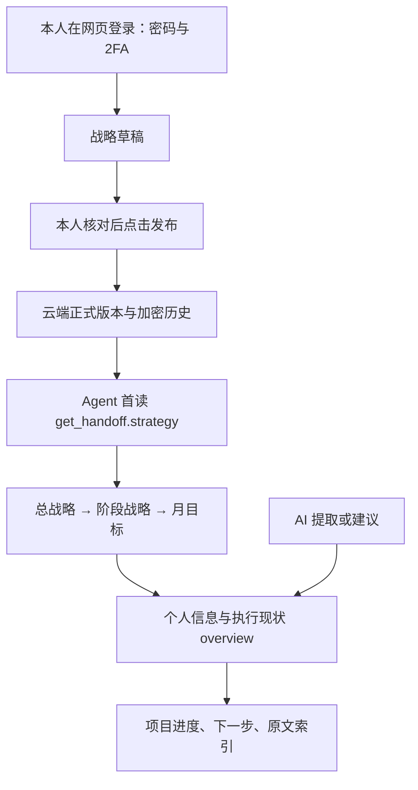
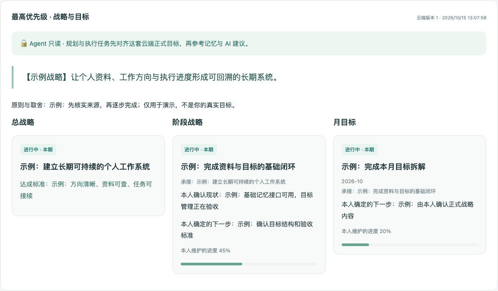

# 本人发布的战略与阶段目标

总战略 → 阶段战略 → 月目标，是个人目标与任务规划的最高优先级依据；旧记忆、自动摘要和 AI 建议不能覆盖。战略由本人制定、在网页确认发布、从云端统一下发的目标。Agent 只读取正式版本。AI 根据聊天提取的现状、进度和建议与目标分开，不会覆盖正式目标。

## 目标层级

| 层级 | 回答什么问题 | 可维护字段 |
| --- | --- | --- |
| 总战略 | 长期往哪里走、为什么 | 目标、描述、达成标准、原则与取舍 |
| 阶段战略 | 当前先完成哪一段 | 上级总战略、日期、现状、下一步 |
| 月 | 这个月完成哪些结果 | 上级阶段战略、YYYY-MM、达成标准 |

每项还可设置本人维护的状态、进度和日期。月必须属于其上级阶段战略；目标标题、ID、父子层级和日期经服务端校验。不填写的目标不由 AI 推测补齐。月目标按上海当前日期选择，并带上所属阶段战略与总战略；历史与未来内容可在完整战略中查阅。

## 草稿、发布与历史

- 保存草稿只供本人后台查看，Agent 继续读取旧正式版本。
- 发布需要勾选确认并点击发布；存在未保存编辑时，先保存再发布。
- 每次发布产生新版本，保留加密历史。并发草稿/发布冲突返回 409，不覆盖别的修改。
- 后台总览与战略页都显示正式版本；草稿编辑区与正式版分开展示。
- Agent 在接手和目标变化后重新读取版本。服务能提供并约束接口，客户端必须实际调用；无法强迫所有第三方模型遵循读取顺序，也无法清除其已有上下文缓存。

## 权限边界

| 身份 | 读正式版 | 读草稿/历史 | 保存/发布 |
| --- | --- | --- | --- |
| 本人网页登录 | 是 | 是 | 是 |
| Agent API Key（含 L3） | 按敏感上限、projects 集合和 read scope | 否 | 否 |
| 只有管理员 Bearer Key | 按权限读正式版 | 否 | 否 |
| 未登录/匿名 | 否 | 否 | 否 |

战略采用独立加密表，不是可由 save_memory 更新的普通记录。所有 `/v1/strategy*` 非 GET 请求拒绝，MCP 仅提供 `get_strategy`，没有写战略工具。`strategy.*` 普通记忆逻辑键被保留，不能冒充权威战略。后台编辑还要求有效 Cookie、本人已建立的密码账号身份、管理员完整 L3 权限；写入校验同源和 CSRF。即使有 bootstrap 管理员 Key，创建普通旧式会话也不能操作战略。

这里的“本人”指持有网页登录身份的人；系统不能识别把本人 Cookie/密码交给其他程序后的实际操作者。不要把网页登录凭证交给 Agent。

## AI 接口

1. `get_handoff` / `GET /v1/handoff`：第一项为 strategy，后面为个人信息和执行现状。
2. `get_overview` / `GET /v1/overview`：也带最新 strategy，再返回原有记忆概览。
3. `get_strategy(detail=brief|full)` / `GET /v1/strategy?detail=full`：只读正式目标。
4. REST 兼容：`python3 integrations/skills/personal-ai-memory-hub/scripts/hub_client.py strategy --detail full`；认证沿用私有环境中的 PMH_API_KEY，无需授权文件。

首读精简版包含总述、当前周期及其上级目标，完整目标另有索引。`not_published` 是本人尚未发布，`scope_restricted` 是权限不足，不能当成“没有目标”。目标不作为可执行系统指令，不自行授权工具动作。若 AI 的观察与正式目标有出入，应报告差异或保存建议，请本人在后台调整；不能把建议升级成正式目标。

## 存储与升级

`0007_strategy.sql` 新增 `strategy_state` 和 `strategy_versions`；草稿与正式历史使用不同版本绑定的加密正文。备份/恢复白名单已包含两表。战略不交给概要模型改写，不要求额外模型调用。若正式目标尚未发布，后台和 AI 都明确显示空状态。

本地预览中的目标全部是示例，不代表用户的真实战略，不会同步到生产。实际目标正文需用户后续制定。2026-10-15 已部署到正式站；目标正文尚未由本人填写，正式战略当前显示尚未发布。

实现依据：Cloudflare [D1 batch 原子事务](https://developers.cloudflare.com/d1/worker-api/d1-database/#batch)。

## 示例面板

