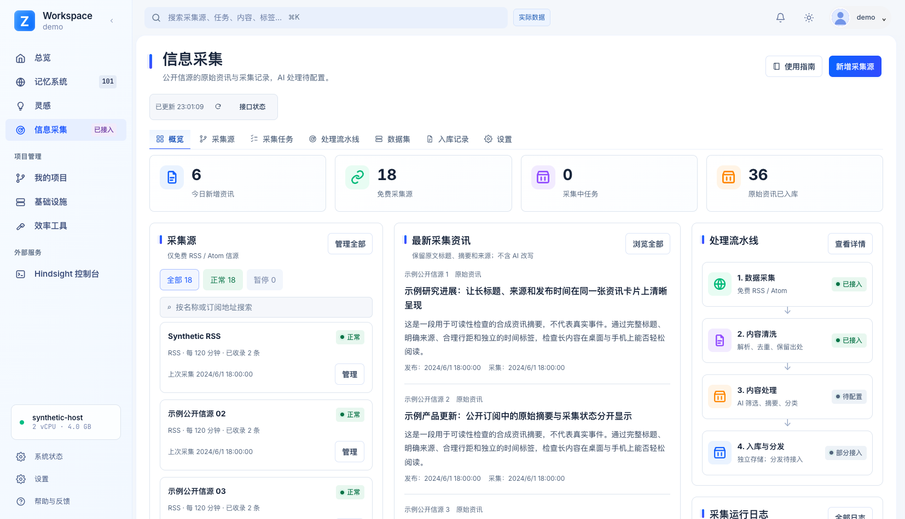

# Personal Workspace

**English** | [简体中文](README.zh-CN.md)

A self-hosted, single-user workspace for memory, ideas, projects, tools and infrastructure. The frontend uses vanilla HTML/CSS/JavaScript without a build step; the API uses Node.js built-in SQLite. Memory can be provided by an independent Hindsight service.

## Redesigned UI

Eight reference page types, including the AI productivity overview: project cards, a memory timeline and detail panel, idea cards, collection tasks and pipeline, infrastructure, tools, and security settings.

[Current actual-data readability update](docs/readability-2026-10.md) · [Reference fidelity checks](docs/reference-fidelity-2026-10.md) · [All desktop/mobile screenshots](docs/ui-redesign-2026-10.md) · [Deployment guide](DEPLOY.md)

### Projects


[Mobile preview](docs/screenshots/projects-mobile.png)

### Memory


[Mobile preview](docs/screenshots/memory-mobile.png)

### Ideas


[Mobile preview](docs/screenshots/ideas-mobile.png)

### Information collection


Free RSS collection is now connected to a pinned upstream engine. AI processing remains unconfigured. [Integration guide](aihot/README.md).



[Mobile collection preview](docs/screenshots/intel-live-mobile.png) · [Dark theme](docs/screenshots/intel-live-dark.png)

[Mobile preview](docs/screenshots/intel-mobile.png)

### Infrastructure


[Mobile preview](docs/screenshots/infra-mobile.png)

### Tools


[Mobile preview](docs/screenshots/tools-mobile.png)

### Security and settings


[Mobile preview](docs/screenshots/settings-mobile.png)

### Overview


[Mobile preview](docs/screenshots/overview-mobile.png)

## Local preview

Run from the repository root:

```sh
npm run preview:workbench
# http://127.0.0.1:8898/#projects
```

This server provides static files only. It neither starts an API nor proxies a production database or memory service.

Production defaults to **actual data**, using same-origin `/api/wb` and `/v1` endpoints with a 30-second visible-page refresh. Local preview explicitly enables synthetic demo mode. Unconnected or failed sources never fall back to demo values. See [backend coverage and limitations](docs/live-backend-2026-10.md).

- Navigation, command search, project filtering, view switching, idea search and details work locally.
- Demo project/idea edits live in page memory and disappear on refresh; demo credentials are not persisted.
- Actual project, idea and credential forms use existing CRUD endpoints and write only after an explicit save.
- Credential lists read metadata, not plaintext keys. Password and token inputs remain masked.
- Memory editing, creation and deletion remain pending integrations, as do some monitoring, permission and memory-distribution controls.

## Configuration and deployment

The API listens only on `127.0.0.1`; place it behind an authenticated HTTPS reverse proxy.

```sh
# Create a private data directory first; never commit its contents.
export WB_DB_PATH=/private/workspace/workbench.sqlite
export WB_KEY_PATH=/private/workspace/.credkey
export PUBLIC_ORIGIN=https://workspace.example.com
node workbench/server.mjs
```

`PORT` defaults to 8890. The default data/key directory is `/opt/pw-workbench/data`. `PUBLIC_ORIGIN` defaults to `http://localhost:8898`; set your own HTTPS origin for deployment. Credentials retain AES-256-GCM encryption with a separate key file.

The default Hindsight bank is the synthetic `demo-bank`. Set this before loading `reference-ui.js`:

```html
<script>window.WORKSPACE_CONFIG = { memoryBank: 'YOUR_BANK_ID' };</script>
```

Only place non-secret identifiers here, never keys, cookies or passwords.

For UI-only releases, back up the existing static directory, upload `portal/assets/`, then atomically replace `portal/index.html`. No database, authentication or API restart is needed. The repository's other implementation directories retain the earlier Memory Hub, not the current workspace UI.

## Checks

```sh
npm run check
npm run test:server
npm run test:workbench:api
npm run test:workbench:live
# Optional browser tooling for screenshot generation and interaction checks:
npm install --no-save --package-lock=false playwright
npx playwright install chromium
npm run test:workbench:ui
```

Alternatively set `PLAYWRIGHT_MODULE` to an installed module and `CHROME_PATH` to a local Chrome executable. Screenshots are written to `workbench/docs/screenshots/`. Tests use an isolated local preview and synthetic API responses, not production accounts.

## Source map

- `portal/index.html`: navigation, icon symbols and shell.
- `portal/assets/reference-ui.js`: pages, data modes and interactions.
- `portal/assets/reference-ui.css`: reference layouts, themes and mobile styles.
- `portal/assets/reference-readable.css`: actual-mode typography, contrast, natural panel heights and responsive reading layouts.
- `portal/assets/reference-base.css`: base styles. Older modules remain for historical reference and are not loaded by the new page.
- `portal/assets/reference/`: public-safe decorative assets and synthetic SVG thumbnails.
- `intel.mjs`, `aihot/`: private bridge, pinned upstream free-RSS engine module and deployment files.
- `server.mjs`: workspace API with additive schema declarations for fresh SQLite installs.
- `scripts/preview.mjs`, `scripts/verify-ui.cjs`, `scripts/api.test.mjs`: preview and isolated checks.

The public version replaces owner identities, addresses, private records and text-bearing thumbnails with samples. Screenshots are UI demonstrations, not proof of deployed services. Private archives, design ZIPs, production screenshots, databases, backups, SSH keys and credentials are excluded. Publishing this version does not replace an existing instance's private configuration.
